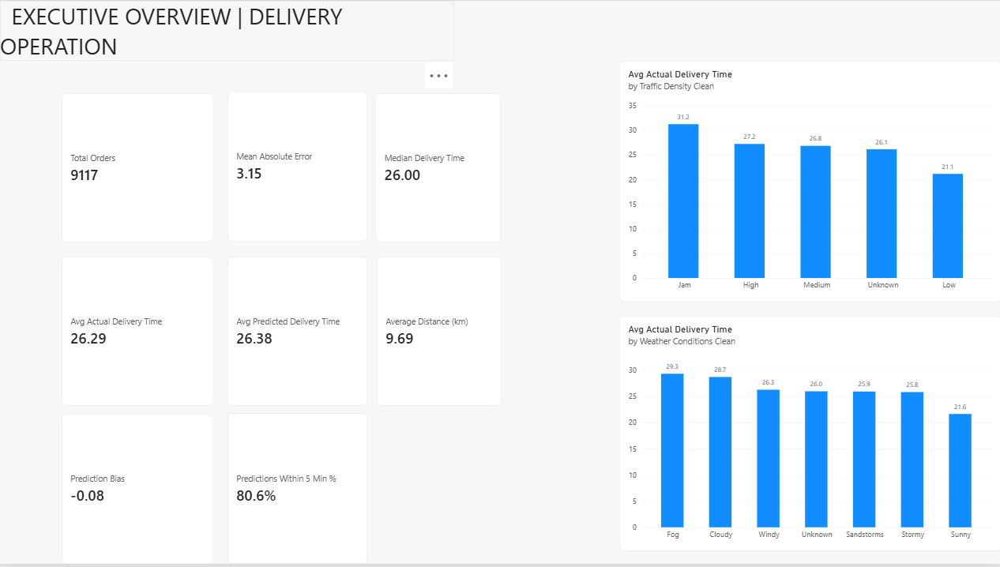
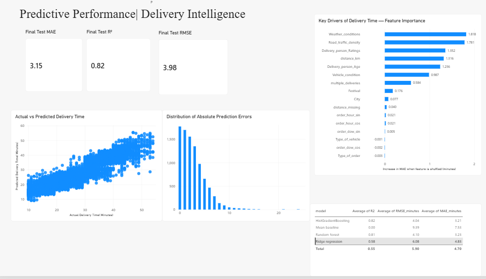

# FULFILLMENT PULSE

**Food-delivery ETA prediction, operational analytics, and model monitoring**

**Author:** Trishit Dev Mukherjee

**Tools:** Python · Pandas · NumPy · scikit-learn · SQLite · SQL · Power BI

FULFILLMENT PULSE is an end-to-end data analytics and applied machine-learning project. It examines a public food-delivery dataset, engineers operational features, compares regression models for delivery-time estimation, analyses held-out predictions with SQL, and communicates operational and model-performance patterns through a two-page Power BI report.

> **Data provenance:** The project uses the public [`aneesarom/Food-Delivery` dataset on Hugging Face](https://huggingface.co/datasets/aneesarom/Food-Delivery), which is associated with a third-party dataset attributed to Zomato delivery operations. That attribution has not been independently verified as an official Zomato production-data release. This is not proprietary Zomato data and the project is not affiliated with Zomato.

---

## Project at a glance

| Item | Project result |
|---|---:|
| Source dataset records | 45,584 |
| Source training split | 36,467 |
| Held-out source test split | 9,117 |
| Model selected | HistGradientBoostingRegressor |
| Test MAE | **3.154 minutes** |
| Test RMSE | **3.981 minutes** |
| Test R² | **0.820** |
| Predictions within ±5 minutes | **80.62%** |
| SQL analysis | 20 core query sections + 1 optional threshold query |
| Power BI report | 2 pages |

The model was selected using validation MAE on a split drawn from the 36,467-row training partition. The selected pipeline was then refitted on the full source training split and evaluated on the separate 9,117-row source test split. The test set was not used for model selection.

## Business questions

1. What data-quality issues exist in the source delivery dataset, and how should they be handled before modelling?
2. How accurately can delivery duration be estimated from the available order and operating-condition features?
3. How do observed delivery durations vary across traffic, weather, distance and other dataset categories?
4. Where are prediction errors concentrated, and which groups warrant closer model monitoring?
5. Can the findings be communicated through reproducible SQL analysis and an interactive BI report?

## Model development and evaluation

Notebook 2 prepares the modelling data, engineers 16 input features, compares regression approaches, selects a model on validation MAE, refits the selected pipeline on the complete training split, and evaluates it on the held-out test split.

### Validation comparison

| Model | Validation MAE (min) | Validation RMSE (min) | Validation R² |
|---|---:|---:|---:|
| HistGradientBoosting | **3.2111** | **4.0372** | **0.8153** |
| Random Forest | 3.2290 | 4.0954 | 0.8099 |
| Ridge Regression | 4.8287 | 6.0813 | 0.5808 |
| Mean baseline | 7.5269 | 9.3932 | approximately 0.000 |

HistGradientBoosting had the lowest validation MAE and was selected for final evaluation.

### Final held-out test metrics

| Metric | Result |
|---|---:|
| Training rows used for final fit | 36,467 |
| Held-out test rows | 9,117 |
| MAE | **3.154 min** |
| RMSE | **3.981 min** |
| R² | **0.820** |
| Predictions within ±5 minutes | **80.62%** |

The ±5-minute figure is an analytical error tolerance for this project. It is not a customer delivery promise, operational SLA, or guarantee.

## Key findings from the held-out test sample

All findings below describe the 9,117-row test sample. Grouped comparisons are descriptive and do not establish causation.

### Operational patterns

- **Traffic:** Jam traffic averaged **31.21 minutes**, compared with **21.13 minutes** under Low traffic. Jam also had the highest MAE among known traffic categories at 3.48 minutes.
- **Weather:** Fog averaged **29.32 minutes**, compared with **21.64 minutes** for Sunny conditions.
- **Traffic × weather:** Fog + Jam was the slowest displayed combination at **37.06 minutes** across 507 orders. Sunny + Medium was the fastest displayed combination at **19.98 minutes** across 313 orders. The interaction query displayed groups with at least 10 records; four test records in smaller groups were excluded.
- **Distance:** For the 8,306 records with a valid distance estimate, average delivery time increased from 22.32 minutes in the 0–5 km band to 29.86 minutes in the 10–15 km band, then was slightly lower at 29.72 minutes for 15+ km. Distance is a straight-line Haversine estimate, not road-route distance.
- **Multiple-delivery field:** Average delivery time ranged from 22.84 minutes for recorded value `0.0` to 47.67 minutes for value `3.0`. The numeric source codes are retained as-is; their exact operational meaning should be confirmed before translating them into business policy.
- **Courier ratings:** The 4.5–5.0 rating band represented 77.69% of test records and averaged 24.25 minutes. These are unadjusted associations, not evidence that rating causes faster delivery.
- **Festival indicator:** Records marked `Yes` averaged 45.32 minutes across 173 orders, compared with 25.99 minutes for records marked `No`. The source flag is not a separately verified event calendar or measure of festival demand.

### Model error patterns

- **Error bands:** 38.07% of predictions were within 2 minutes; 42.55% had errors over 2 and up to 5 minutes; 17.82% had errors over 5 and up to 10 minutes; 1.56% had errors above 10 minutes.
- **Prediction direction:** 4,828 predictions (52.96%) were overpredictions, 4,286 (47.01%) were underpredictions, and 3 were near-exact using a 0.001-minute tolerance. Overall mean bias was approximately **−0.08 minutes**.
- **Error by traffic:** Jam traffic had MAE of 3.48 minutes, while Low traffic had MAE of 2.67 minutes. Unknown traffic had MAE of 6.15 minutes, but represented only 119 records.
- **Severe errors:** Severe error is defined here as absolute error greater than 10 minutes. The Unknown + Unknown weather/traffic group had 25 such errors among 119 orders (21.01%). Among known combinations, Sandstorms + High had the highest displayed severe-error rate (6.71%, 10 of 149 orders). These are monitoring signals; the group sizes and missingness must be considered.

### Feature importance

Permutation importance was calculated on a reproducible sample of up to 2,500 held-out test records, with three repeats and negative MAE scoring. The strongest mean importance values were Weather conditions (1.8183), Road traffic density (1.7806), Delivery person ratings (1.3525), Distance (1.3155), and Delivery person age (1.2361). Permutation importance measures model reliance in this evaluation sample; it does not measure causal impact.

## Power BI report

The report contains two pages:

1. **Executive Overview:** order volume and delivery KPIs, average delivery time by traffic category, and average delivery time by weather category.
2. **Predictive Performance:** actual-versus-predicted delivery time, absolute-error distribution, validation model comparison, feature importance, and final test metrics.

The published Power BI file is `dashboard/PowerBI/PowerBI.pbix`. The two page previews are stored at the following paths:

- `dashboard/screenshots/executive_overview.png`
- `dashboard/screenshots/predictive_performance.png`

The dashboard previews are embedded below:





## Repository structure

```text
FULFILLMENT-PULSE/
├── .gitignore
├── README.md
├── requirements.txt
├── data/
│   ├── README.md
│   ├── raw/.gitkeep
│   ├── processed/.gitkeep
│   └── exports/
│       ├── README.md
│       └── .gitkeep                 # generated CSVs are local and Git-ignored
├── dashboard/
│   ├── README.md
│   ├── PowerBI/
│   │   └── PowerBI.pbix
│   └── screenshots/
│       ├── executive_overview.png
│       └── predictive_performance.png
├── docs/
│   ├── README.md
│   ├── data_dictionary.md
│   ├── data_sources.md
│   ├── methodology.md
│   ├── project_structure.md
│   └── reproducibility.md
├── models/
│   ├── .gitkeep
│   ├── README.md
│   └── fulfillment_pulse_eta_model.joblib
├── notebooks/
│   ├── 01_data_ingestion_quality_audit.ipynb
│   └── 02_delivery_time_prediction.ipynb
├── reports/
│   ├── business_insights.md
│   └── model_evaluation.md
├── scripts/
│   └── load_predictions.py
└── sql/
    ├── README.md
    ├── business_analysis.sql
    └── schema.sql
```

The PBIX report, trained model binary, and dashboard screenshots are included in the repository. The source dataset, local SQLite database, and row-level prediction CSV exports are excluded by `.gitignore`; regenerate them locally by following the reproducibility instructions.

## Technology stack

- **Python:** data ingestion, data-quality checks, preprocessing, feature engineering and model evaluation
- **Pandas / NumPy:** data manipulation and numerical operations
- **scikit-learn:** preprocessing pipelines, regression models, metrics and permutation importance
- **Matplotlib / Seaborn:** exploratory and model-result visualisations
- **SQLite / SQL:** data validation, aggregation, segmentation and business analysis
- **Power BI Desktop / DAX:** interactive executive and predictive-performance dashboards
- **Google Colab / Jupyter:** notebook execution

## Reproducing the project

### 1. Obtain the data and run the notebooks

Open the notebooks in Google Colab or a local Jupyter environment. Run them in order:

1. `notebooks/01_data_ingestion_quality_audit.ipynb`
2. `notebooks/02_delivery_time_prediction.ipynb`

Notebook 2 exports the held-out test predictions, trained model, validation comparison, final metrics and permutation importance under `fulfillment_pulse_outputs/` in the notebook runtime. Download the required outputs and place them in the repository folders shown above.

### 2. Create the SQLite database

From the repository root, place `fulfillment_pulse_test_predictions.csv` in `data/exports/` and run:

```bash
python scripts/load_predictions.py "data/exports/fulfillment_pulse_test_predictions.csv"
```

The loader creates `fulfillment_pulse.db` in the repository root and imports the prediction rows into the `delivery_predictions` table. Open the database with a SQLite client or the VS Code SQLite extension, then execute the queries in `sql/business_analysis.sql`. See `sql/README.md` for details.

### 3. Open the Power BI report

Open `dashboard/PowerBI/PowerBI.pbix` in Power BI Desktop and refresh its data sources if needed.

### 4. Python dependencies

Create and activate a virtual environment, then install the dependencies:

```bash
python -m venv .venv
```

Windows PowerShell:

```powershell
.venv\Scripts\Activate.ps1
```

macOS / Linux:

```bash
source .venv/bin/activate
```

Install project packages:

```bash
pip install -r requirements.txt
```

The notebooks may also install their own dependencies when run in Colab.

## Data, interpretation and security notes

- The evaluation results describe a held-out test sample of 9,117 records, not all 45,584 source rows.
- The public dataset's Zomato attribution is not independently verified as an official company data release.
- The distance feature is a Haversine straight-line estimate, not route distance.
- Missing operational fields are retained where supported by the preprocessing pipeline; missingness can itself be informative and can also reflect data-quality limitations.
- The five-minute tolerance and ten-minute severe-error threshold are project-defined analytical thresholds, not service-level commitments.
- Group-level findings are descriptive. No causal inference or controlled experiment was performed.
- Permutation importance is not causal explanation.
- Numeric category codes should not be assigned operational meaning without source documentation.
- A `.joblib` file is a pickle-based artifact. Load only model files you created or otherwise trust.
- Check the dataset's terms and redistribution conditions before publishing any source or row-level data. The SQLite database and raw source data are not required to reproduce the analysis and should generally remain outside the public repository.

## Project status

- [x] Source data audit notebook completed
- [x] Delivery-time modelling and held-out test evaluation completed
- [x] Two-page Power BI report designed
- [x] SQL analysis developed and findings documented
- [x] Business insights report consolidated
- [x] Final PBIX and dashboard screenshots included in the repository
- [x] Initial GitHub publication completed

## Author

**Trishit Dev Mukherjee**  
B.Sc. Computer Science, KIIT University  
GitHub: [@TempestAsuna](https://github.com/TempestAsuna)
